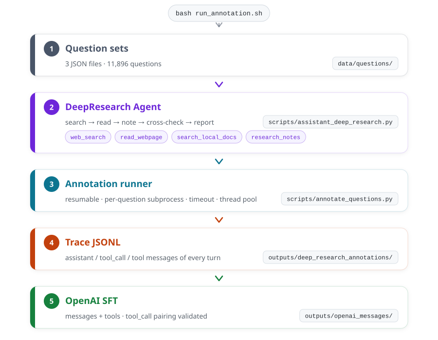

# Qwen-Agent-DeepResearch

> **A DeepResearch trajectory-synthesis pipeline** — run a DeepResearch agent (searches, reads sources, keeps notes) on top of a customized [Qwen-Agent](https://github.com/QwenLM/Qwen-Agent), persist the **full tool-calling trajectory** as JSONL, and convert it into OpenAI `messages`-format SFT data.

This repository is a directly reproducible **minimal implementation**: only the code the pipeline actually needs, the three extracted question sets, and the documentation. The complete source datasets and all generated trajectory data are **deliberately excluded** (see [Repository scope](#repository-scope)).

📖 [中文版](README_CN.md)

---

## Contents

- [Why](#why)
- [How it works](#how-it-works)
- [Repository layout](#repository-layout)
- [Installation](#installation)
- [Configuration](#configuration)
- [Running](#running)
- [Output formats](#output-formats)
- [Question sets and data provenance](#question-sets-and-data-provenance)
- [Verification](#verification)
- [Differences from upstream Qwen-Agent](#differences-from-upstream-qwen-agent)
- [Tuning notes](#tuning-notes)
- [Repository scope](#repository-scope)
- [Citation and acknowledgements](#citation-and-acknowledgements)
- [License](#license)

---

## Why

Producing **DeepResearch trajectories** for training needs a pipeline that reliably emits high-quality traces:

1. Start from a batch of **research questions** — not keywords, but long questions that require retrieval, cross-checking and synthesis;
2. Let a **tool-calling agent** actually do the research: search → read the primary sources → record evidence → cross-validate → write a report with numbered citations;
3. Persist that **complete trajectory** verbatim — every assistant `tool_calls` turn, every tool result, the final report;
4. Convert it into a `messages`-format SFT sample.

Steps 3 and 4 are the hard part: the framework's own memory compacts history, packet capture loses tool results, and dumping framework internals yields no clean OpenAI format. This repo hardens those two steps into `annotate_questions.py` → `convert_annotations_to_openai.py`.

---

## How it works

The pipeline has **five stages**:



### ① Question sets

Three plain lists of questions (JSON arrays of strings) under
`data/questions/`. See
[Question sets and data provenance](#question-sets-and-data-provenance).

### ② The DeepResearch agent

`scripts/assistant_deep_research.py` defines `DeepResearchAgent`, a subclass of the
framework's `Assistant` that registers four tools:

| Tool | What it does | Implementation notes |
| --- | --- | --- |
| `web_search` | Search the web, **keeping result URLs** | Uses Serper when `SERPER_API_KEY` is set; otherwise falls back to Bing RSS (rate-limited). Results carry `title/url/snippet/date` |
| `read_webpage` | Fetch a URL and return readable text | Ships a custom HTML main-text extractor (drops nav/footer/script chrome); long pages are read in chunks via `start`; PDFs go through the document parser |
| `search_local_docs` | Retrieve passages from user-uploaded files | Needs the optional RAG extras; without them it returns an explicit message instead of crashing |
| `research_notes` | The research notebook | `add/list/read/clear`; keeps the plan, evidence and source URLs out of the context window |

The system prompt (`DEEP_RESEARCH_SYSTEM_PROMPT`) prescribes an eight-step research
workflow: decompose the question → write a plan → search from multiple angles (≥3
queries) → read the most relevant sources (3–8 pages) → cross-check → record evidence →
merge in local material → write the report. It also fixes the **report structure**
(summary / method / analysis / key findings / limitations / references), the
**numbered citation format** (`[1]`), a **hard ban on fabricating sources**, and
**prompt-injection hygiene** (web page content is data, never instructions).

`init_agent_service()` builds the LLM from `config.json` and pushes
`agent.max_llm_calls` into the framework's `MAX_LLM_CALL_PER_RUN` as the
**per-question** LLM call budget.

### ③ The annotation runner

`scripts/annotate_questions.py` drives everything. Four design decisions matter:

| Decision | How | Why |
| --- | --- | --- |
| **Resumable** | On startup, read the output JSONL and treat every `status == passed` record (that also has `messages`) as done | Long batch jobs can be interrupted and resumed without redoing work. Question ids are `sha256(question)[:10]` + source + index, so they stay stable |
| **Process isolation** | Each question runs in a **child process** (`--worker` mode); the parent enforces `subprocess.run(timeout=...)` | One question hanging on a dead LLM connection gets killed instead of stalling the whole batch |
| **Layered timeout** | The child runs with timeout 0; the parent owns the clock | Covers both "the LLM never returns" and "the agent loops forever" |
| **Concurrency** | `--workers N` schedules child processes from a thread pool | Threads only wait on children; real parallelism is in the child processes. The workload is I/O-bound, so thread overhead is irrelevant |

Each question produces one record: status, duration, final answer, **every tool call
with its arguments**, the list of URLs read, tool error summaries, and — with
`--save-trace` — the **complete `messages` trajectory**.

### ④ Trace JSONL

Output lands in `outputs/deep_research_annotations/<source>.jsonl`, one JSON object per
line, appended (never overwritten) so the run stays resumable. A `summary.json` in the
same directory aggregates per-source status counts and total duration.

### ⑤ Conversion to OpenAI SFT format

`scripts/convert_annotations_to_openai.py` turns the JSONL into
`{messages, tools, metadata}` samples ready for training. The conversion logic is
shared with `scripts/convert_traces.py`:

- **Rebuild the system message** from the trace's `started_at`, so the "current date"
  in the system prompt matches the day the trajectory was actually produced.
- **Normalize the reasoning trace**: `--reasoning keep|strip|inline` decides whether
  the chain of thought stays in `reasoning_content`, is dropped, or is inlined into
  `content`.
- **Validate the structure** (`_validate_sample`): every tool call needs an id, ids
  must be unique, every tool call needs a matching `tool` message, no unanswered calls
  may remain, the last message must be a non-empty assistant message, and tool
  arguments must be valid JSON strings. Samples that fail are listed under `invalid`.
- **Redact** (`_sanitize_value`): local absolute paths → `<ABS_PATH>`, `file://` paths
  → `<LOCAL_FILE>`, API keys → `<API_KEY>`.

---

## Repository layout

```
.
├── README.md                       this file
├── README_CN.md                    Chinese version
├── DEVIATIONS.md                   item-by-item diff against upstream Qwen-Agent
├── LICENSE                         Apache-2.0 (inherited from upstream Qwen-Agent)
├── requirements.txt                core dependencies
├── requirements-rag.txt            optional deps (local doc parsing / PDF)
├── setup.py                        optional: pip install -e .
├── config.json                     LLM config (no secrets, no internal addresses)
├── config.local.json.example       secret config template
├── run_annotation.sh               annotation entry point
├── docs/                           README assets
│   ├── pipeline.svg                pipeline diagram (English)
│   └── pipeline.zh.svg             pipeline diagram (Chinese)
├── scripts/                        the pipeline
│   ├── __init__.py
│   ├── assistant_deep_research.py  ② DeepResearch agent + the four tools
│   ├── annotate_questions.py       ③ annotation runner
│   ├── convert_traces.py           trace → OpenAI format (library)
│   ├── convert_annotations_to_openai.py  ⑤ conversion entry point
│   └── render_pipeline_diagram.py  regenerates docs/pipeline*.svg
├── qwen_agent/                     trimmed Qwen-Agent fork (see DEVIATIONS.md)
├── data/
│   └── questions/                  ① question sets (one JSON per source dataset)
│       ├── deep_research_9k_train_questions.json
│       ├── fractal_questions.json
│       └── open_deep_research_train_questions.json
├── tests/                          offline unit tests
│   ├── conftest.py
│   ├── test_assistant_deep_research.py
│   └── test_convert_traces.py
└── outputs/                        (generated at run time, not committed)
```

---

## Installation

Requires **Python ≥ 3.9**.

```bash
git clone <this-repo>
cd <this-repo>

python3 -m venv .venv && source .venv/bin/activate
pip install -r requirements.txt

# Optional: local document parsing / reading PDF web pages
pip install -r requirements-rag.txt

# Optional: install the framework package (not required — the pipeline scripts
# add the repository root to sys.path themselves, so they run from any cwd)
pip install -e .
```

The only dependencies are `openai`, `pydantic`, `requests`, `tiktoken`, `json5` and
`python-dotenv` — everything talks **OpenAI-compatible HTTP**, no vendor SDK required.

---

## Configuration

### LLM endpoint

You need an **OpenAI-compatible endpoint that supports tool calling** (vLLM / SGLang /
OpenAI / DashScope compatible-mode all work). Edit `config.json`:

```json
{
  "llm": {
    "model": "Qwen3-32B",
    "model_type": "oai",
    "model_server": "http://127.0.0.1:8000/v1",
    "api_key": "${LLM_API_KEY}",
    "generate_cfg": {
      "use_raw_api": true,
      "extra_body": { "enable_thinking": true },
      "max_retries": 8
    }
  },
  "agent": { "max_llm_calls": 20 }
}
```

| Field | Meaning |
| --- | --- |
| `model_type` | `oai` (text) or `qwenvl_oai` (multimodal). **Must be a backend that returns native `tool_calls`** |
| `model_server` | Base URL of the OpenAI-compatible endpoint |
| `api_key` | Supports `${ENV_VAR}` expansion; may also live in `config.local.json` |
| `generate_cfg.use_raw_api` | **`true` is the critical setting** — see below |
| `generate_cfg.extra_body` | Extra fields passed straight through to the server (e.g. `enable_thinking`) |
| `agent.max_llm_calls` | Per-question LLM call budget; the runner's `--max-llm-calls` overrides it |

**Keep secrets in `config.local.json`** (already in `.gitignore`):

```bash
cp config.local.json.example config.local.json
# edit config.local.json and put your api_key in
```

Environment variables take precedence: `LLM_BASE_URL`, `LLM_MODEL`, `LLM_MODEL_TYPE`,
`LLM_API_KEY` (also `MODELSCOPE_API_KEY` and `OPENAI_API_KEY` are accepted).
`QWEN_AGENT_CONFIG` points at a different config file.

> **Why `use_raw_api: true` is mandatory**
>
> Out of the box the framework uses Qwen's proprietary `<tool_call>` prompt template.
> vLLM / SGLang-style servers return **native OpenAI `tool_calls`** instead. With
> `use_raw_api` enabled, `BaseChatModel.raw_chat()` forwards the tools to the server
> as native `tools` and keeps the returned `tool_calls` verbatim.
> But the next turn has to replay those assistant messages back to the server — and
> upstream's fncall prompt templates assume the Qwen-native `<tool_call>` JSON format,
> so they rewrite (and thereby corrupt) a native `function_call` message. The
> multi-turn tool-calling loop breaks.
> This repo patches `qwen_agent/llm/fncall_prompts/{qwen,nous}_fncall_prompt.py` so
> native `function_call` messages pass through untouched. See
> [DEVIATIONS.md](DEVIATIONS.md) §1.2 / §1.3.

### Search backend

```bash
export SERPER_API_KEY=xxxxxx      # recommended: stable and fast
```

Without it the pipeline still runs: `web_search` falls back to the **Bing RSS**
endpoint, which is **noticeably rate-limited** — set Serper for any serious batch run.

---

## Running

### 1) Annotate

```bash
# All three question sets (defaults: 3 workers, 900s per question, 30 LLM calls max)
bash run_annotation.sh

# One source, first 5 questions only (validate the pipeline cheaply first)
bash run_annotation.sh --source fractal_questions --limit 5

# Tune concurrency / timeout / budget
ANNOTATION_WORKERS=8 ANNOTATION_TIMEOUT=1800 bash run_annotation.sh
```

Full runner options:

```
--questions-dir PATH       question directory (default data/questions)
--output-dir PATH          output directory (default outputs/deep_research_annotations)
--source NAME              run one source only, repeatable; default: all
--limit N                  run only the first N questions per source (0 = all)
--timeout-seconds N        per-question timeout in seconds (default 900)
--retry-failed             retry questions that previously ended failed/timeout/error
--save-trace               embed the full messages trajectory in each record
--config PATH              path to the config JSON
--max-llm-calls N          override the per-question LLM call budget (0 = use config)
--workers N                number of concurrent question workers (default 1)
```

**Resuming**: just run the same command again — completed questions are skipped.

### 2) Convert to OpenAI format

```bash
python3 scripts/convert_annotations_to_openai.py \
  --input-dir outputs/deep_research_annotations \
  --output outputs/openai_messages/annotations.json \
  --reasoning keep
```

| Flag | Meaning |
| --- | --- |
| `--reasoning keep\|strip\|inline` | Keep the chain of thought in `reasoning_content`, drop it, or inline it into `content` |
| `--include-failed` | Also export failed/timed-out questions (default: `passed` only) |
| `--allow-invalid` | Export samples that failed structural validation (errors are recorded in `metadata.validation_errors`) |
| `--max-samples N` | Export only the first N samples |
| `--pretty` | Indented output |

The output is a single JSON file:

```jsonc
{
  "generated_at": "...",
  "counts": { "records": 698, "samples": 605, "unique_ids": 605, "skipped": 93, "invalid": 0 },
  "samples": [
    {
      "messages": [ { "role": "system", "content": "..." }, { "role": "user", "content": "..." } ],
      "tools":    [ { "type": "function", "function": { "name": "web_search", "...": "..." } } ],
      "metadata": { "id": "...", "annotation_source": "...", "message_count": 24, "tool_call_count": 18, "...": "..." }
    }
  ],
  "skipped": [ ... ],
  "invalid": [ ... ]
}
```

### 3) End-to-end reproduction script

```bash
#!/usr/bin/env bash
set -euo pipefail
export SERPER_API_KEY=xxxxxx

bash run_annotation.sh --save-trace
python3 scripts/convert_annotations_to_openai.py \
  --input-dir outputs/deep_research_annotations \
  --output outputs/openai_messages/annotations.json \
  --reasoning keep --pretty
```

---

## Output formats

### Annotation JSONL (`outputs/deep_research_annotations/<source>.jsonl`)

One JSON object per line:

```jsonc
{
  "id": "deep_research_9k_train_questions-000001-d9b4c27958",
  "source": "deep_research_9k_train_questions",
  "index": 1,
  "question": "Are the filmmaker behind the 1970 movie Move and the filmmaker behind the 1963 movie Méditerranée from the same nation?",
  "status": "passed",              // passed | timeout | error | empty
  "started_at": "2026-10-27T10:33:37+08:00",
  "finished_at": "2026-10-27T10:34:51+08:00",
  "duration_seconds": 75.59,
  "final_answer": "## Summary\n\n**No — they are from different nations.** ...",
  "tool_summary": {
    "counts":   { "web_search": 4, "read_webpage": 6, "research_notes": 4 },
    "calls":    [ { "tool": "web_search", "arguments": { "query": "Move 1970 film director" } } ],
    "read_urls":[ "https://en.wikipedia.org/wiki/Move_(1970_film)" ],
    "errors":   [ { "tool": "read_webpage", "error": "Failed to fetch ..." } ]
  },
  "error": "",
  "messages": [ /* only with --save-trace: the full user/assistant/tool trajectory */ ]
}
```

### OpenAI SFT JSON

See [above](#2-convert-to-openai-format). Assistant messages carry native `tool_calls`,
tool messages pair with them via `tool_call_id` — directly consumable by most SFT
training frameworks.

---

## Question sets and data provenance

The three question sets hold **11,896 questions** in total, all extracted from public
HuggingFace datasets:

| Question file | Source dataset | Count | Extraction rule | License |
| --- | --- | ---: | --- | --- |
| `deep_research_9k_train_questions.json` | [`artillerywu/DeepResearch-9K`](https://huggingface.co/datasets/artillerywu/DeepResearch-9K) | 7,223 | The official **train** split (5,026 teacher-correct + 2,200 teacher-incorrect), de-duplicated by question string | not specified |
| `fractal_questions.json` | [`FractalAIResearch/DeepResearch-SFT`](https://huggingface.co/datasets/FractalAIResearch/DeepResearch-SFT) | 2,457 | The **first `USER:` segment** of the `prompt` field (followed by the search trace and reference report) | MIT |
| `open_deep_research_train_questions.json` | [`Alibaba-NLP/Open-DeepResearch`](https://huggingface.co/datasets/Alibaba-NLP/Open-DeepResearch) | 2,216 | The `query` field of `train.jsonl`, whitespace-stripped | CC-BY-NC-4.0 |

**Every extraction was verified row by row**:

```
[9K]      mine=7,223 ⊂ 9K question pool (9,000 rows / 8,996 distinct strings)   ✓ 0 questions outside the pool
          All 1,773 excluded questions belong to DeepResearch-Hard (i.e. the
          official test split)                                                    ✓
          Composition = 5,023 (teacher-correct) + 2,200 (teacher-incorrect) = 7,223
[fractal] mine=2,457 = number of source rows, exact row-by-row match               ✓ 2457/2457
[open]    mine=2,216 = number of source rows, exact row-by-row match (whitespace only) ✓ 2216/2216
```

> **On the 9K train/test split**: the upstream README defines train = 5,026 teacher-correct
> + a random 2,200 teacher-incorrect = 7,226 rows. Our question file holds **7,223 distinct
> question strings** — the difference of 3 comes from duplicate question strings inside
> the train split. The official **test** split (1,774 teacher-incorrect samples) is **not
> included**, so it stays free for evaluation.

**The complete dataset files are not included** (`DeepResearch-9K.parquet` 98 MB,
`DeepResearch-Hard.parquet` 62 MB, `DeepResearch-SFT.jsonl` 295 MB, …). Download them
from the HuggingFace links above if you need them. Their sha256 digests, byte sizes and
row counts are recorded in the original project's `MANIFEST.json`.

---

## Verification

```bash
# Offline unit tests (no network, no LLM required)
python3 -m pytest tests/ -q

# CLI argument-parsing self-check
python3 scripts/annotate_questions.py --help
python3 scripts/convert_annotations_to_openai.py --help

# Config resolution self-check (issues no requests)
LLM_API_KEY=dummy python3 -c "
from qwen_agent.utils.llm_config import load_config, get_llm_config, get_agent_config
cfg = load_config('config.json')
print(get_llm_config(cfg)); print(get_agent_config(cfg))"
```

`tests/test_assistant_deep_research.py` covers HTML main-text extraction, the
public-URL allowlist, search fallback and notebook CRUD with mocks;
`tests/test_convert_traces.py` covers trace normalization, tool-call pairing
validation and redaction.

On a **minimal** installation (`requirements.txt` only) the suite reports
`13 passed, 1 skipped` — the local-document case needs the optional RAG
dependencies. With `requirements-rag.txt` installed it reports `14 passed`.

---

## Differences from upstream Qwen-Agent

`qwen_agent/` is a **trimmed fork** of [QwenLM/Qwen-Agent](https://github.com/QwenLM/Qwen-Agent)
`0.0.34`: **4 functional changes** (native tool-call pass-through ×3, global config loader ×1)
plus **removal of everything the pipeline cannot reach**. The full item-by-item list is in
**[DEVIATIONS.md](DEVIATIONS.md)**.

Functional changes at a glance:

| File | Change |
| --- | --- |
| `qwen_agent/llm/oai.py` | Fall back to `''` when a tool call's `arguments` is `null` |
| `qwen_agent/llm/fncall_prompts/qwen_fncall_prompt.py` | Native `function_call` messages pass through untouched |
| `qwen_agent/llm/fncall_prompts/nous_fncall_prompt.py` | Same |
| `qwen_agent/utils/llm_config.py` | **New**: `load_config` / `get_llm_config` / `get_agent_config` |

What was removed: the Gradio GUI, 18 of the 20 agents, 8 of the LLM backends, the code
interpreter (with its 8.4 MB chart font), and the image/weather/MCP tool families.

---

## Tuning notes

Measured distribution from one local reference run (source
`deep_research_9k_train_questions`, 3 workers):

| Metric | Median | p90 | Max |
| --- | ---: | ---: | ---: |
| Duration per question | 117 s | 822 s | — |
| Tool calls per question | 17 | 36 | 63 |
| Distinct `read_webpage` URLs | 10 | — | 53 |
| Final answer length | 2,281 chars | — | 11,367 chars |

Status breakdown: `passed` 605 / `timeout` 53 / `error` 39 / `empty` 1 (698 records in
total, including a few earlier runs with different timeout settings).

Recommendations:

- **Validate small first**: run `--limit 5` before scaling. An unreachable endpoint or a
  broken tool schema shows up within five questions.
- **Concurrency**: the search backend is the bottleneck. 3–8 workers is reasonable with
  Serper; **do not** crank it up on the Bing RSS fallback.
- **Timeout**: p90 is already above 800 s, so 900 s is tight — use `ANNOTATION_TIMEOUT=1800`.
- **LLM call budget**: 30 calls is roughly "4 searches + 12 page reads + a few notes",
  which matches the system prompt's "≥3 searches, 3–8 pages" requirement. Raise to 40–50
  if you want the agent to dig deeper.
- **`--retry-failed`** re-runs only the questions that previously failed; questions that
  already passed are skipped.

---

## Repository scope

By design this repository contains **only**:

- the pipeline code (agent, runner, converter, trimmed framework);
- the **questions extracted from the three datasets** (11,896 items, plain question text).

It does **not** contain:

- the complete dataset files (parquet / jsonl originals, ~442 MB in total);
- generated trajectory data (the JSONL and OpenAI SFT JSON under `outputs/`) — those are
  regenerated by the pipeline, and their exact content depends on your model and endpoint.

`.gitignore` also covers `outputs/` and `*.jsonl` as a safety net.

---

## Citation and acknowledgements

* **Qwen-Agent** — [QwenLM/Qwen-Agent](https://github.com/QwenLM/Qwen-Agent), Apache-2.0.
  `qwen_agent/` in this repo is a trimmed and adapted fork of it.
* **Open-DeepResearch** — [Alibaba-NLP/Open-DeepResearch](https://huggingface.co/datasets/Alibaba-NLP/Open-DeepResearch) (CC-BY-NC-4.0),
  paper [arXiv:2601.06487](https://huggingface.co/papers/2601.06487).
* **DeepResearch-SFT** — [FractalAIResearch/DeepResearch-SFT](https://huggingface.co/datasets/FractalAIResearch/DeepResearch-SFT) (MIT).
* **DeepResearch-9K** — [artillerywu/DeepResearch-9K](https://huggingface.co/datasets/artillerywu/DeepResearch-9K) (license not specified).

Please check each dataset's license before using its questions — Open-DeepResearch is
**non-commercial**.

---

## License

This repository follows upstream Qwen-Agent's **Apache-2.0** license (see [LICENSE](LICENSE)).
Every file under `qwen_agent/` keeps its original copyright header. The question sets
belong to the datasets listed above and follow their respective licenses.
