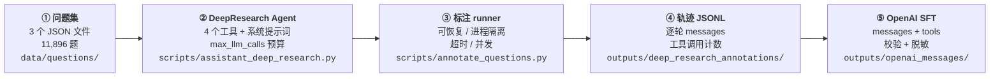

# Qwen-Agent-DeepResearch

> **DeepResearch 轨迹合成流水线** —— 在定制化 [Qwen-Agent](https://github.com/QwenLM/Qwen-Agent) 上跑一个会搜索、会精读、会写笔记的 DeepResearch Agent，把**完整工具调用轨迹**落盘成 JSONL，再转换成 OpenAI `messages` 格式的 SFT 数据。

本仓库是可直接复现的**最小实现**：只包含这条流水线真正需要的代码、三份已抽取好的问题集，以及配套说明文档。
完整数据集文件与已生成的轨迹数据**均未收录**（原因见 [仓库内容边界](#仓库内容边界)）。

---

## 目录

- [任务背景](#任务背景)
- [实现路径](#实现路径)
- [仓库结构](#仓库结构)
- [安装](#安装)
- [配置](#配置)
- [运行](#运行)
- [输出格式](#输出格式)
- [问题集与数据来源](#问题集与数据来源)
- [验证](#验证)
- [与上游 Qwen-Agent 的差异](#与上游-qwen-agent-的差异)
- [参数调优建议](#参数调优建议)
- [仓库内容边界](#仓库内容边界)
- [引用与致谢](#引用与致谢)
- [许可](#许可)

---

## 任务背景

要做 DeepResearch 领域的**轨迹合成（trajectory synthesis）**，需要一条能稳定产出高质量轨迹的流水线：

1. 拿一批**研究型问题**（不是一个词，是需要检索、交叉验证、综合的长问题）；
2. 让一个**具备工具调用能力的 Agent** 真正去做研究：多轮搜索 → 精读原文 → 记录证据 → 交叉验证 → 写出带引用编号的报告；
3. 把这条**完整轨迹**（每一轮 assistant 的 `tool_calls`、每一次工具返回的原文、最后的报告）**逐字保存**下来；
4. 转换成 SFT 训练可用的 `messages` 格式。

难点在第 3、4 步：框架自带的记忆会压缩历史，抓包会丢掉工具结果，直接 dump 框架内存又拿不到干净的 OpenAI 格式。
本仓库把这三步固化成了 `annotate_questions.py` → `convert_annotations_to_openai.py` 两个脚本。

---

## 实现路径

整条链路是**五个阶段**，从左到右：



### ① 问题集

三份纯问题列表（JSON 数组，元素是问题字符串），放在
`data/questions/`。来源与抽取规则见
[问题集与数据来源](#问题集与数据来源)。

### ② DeepResearch Agent

`scripts/assistant_deep_research.py` 定义了 `DeepResearchAgent`，它继承框架的 `Assistant`，
注册 4 个工具：

| 工具 | 作用 | 实现要点 |
| --- | --- | --- |
| `web_search` | 搜网页，**保留结果 URL** | 有 `SERPER_API_KEY` 走 Serper；否则降级到 Bing RSS（限流）。结果带 `title/url/snippet/date` |
| `read_webpage` | 打开 URL 读正文 | 自带 HTML 正文抽取器（丢掉 nav/footer/script 等页面框架），长页用 `start` 分段读；PDF 走文档解析 |
| `search_local_docs` | 检索用户上传的本地文件 | 依赖 RAG 扩展，没装会返回明确提示而不是崩掉 |
| `research_notes` | 研究笔记本 | `add/list/read/clear`，把计划、证据、来源 URL 记下来，减少上下文占用 |

系统提示词（`DEEP_RESEARCH_SYSTEM_PROMPT`）规定了一套 8 步研究流程：拆解问题 → 写计划 → 多角度搜索（≥3 次）→ 精读来源（3–8 篇）→ 交叉验证 → 记录证据 → 合并本地资料 → 写报告。
同时规定**报告结构**（摘要 / 方法 / 分析 / 关键发现 / 局限 / 参考来源）、**编号引用格式**（`[1]`）、**禁止编造来源**，以及**把网页内容当数据不当指令**的注入防护。

`init_agent_service()` 负责从 `config.json` 装配 LLM，并把 `agent.max_llm_calls` 写进框架的
`MAX_LLM_CALL_PER_RUN`，作为**每个问题**的 LLM 调用预算。

### ③ 标注 runner

`scripts/annotate_questions.py` 是整条流水线的驱动脚本，四个关键设计：

| 设计 | 做法 | 为什么 |
| --- | --- | --- |
| **可恢复** | 每次启动先读输出 JSONL，把 `status == passed`（且有 `messages`）的题目 id 记入已完成集合并跳过 | 长时间批量任务中断后能直接续跑，不用从头再来。题目 id = `sha256(question)[:10]` + 源名 + 序号，稳定不变 |
| **进程隔离** | 每道题在**子进程**里跑（`--worker` 模式），父进程用 `subprocess.run(timeout=...)` 兜底 | 一道题把 LLM 连接卡死时，可以直接杀掉子进程，而不是整批挂住 |
| **超时分级** | 子进程内 0 超时（由父进程计时），父进程 `--timeout-seconds` 兜底 | 同时覆盖「LLM 不返回」和「agent 内部死循环」两类挂起 |
| **并发** | `--workers N` 用线程池调度子进程 | 线程只等子进程，真正的并行在子进程里；I/O 密集，线程开销可忽略 |

每题产出一条记录，包含状态、耗时、最终答案、**逐个工具的调用参数**、读过的 URL 列表、工具报错摘要，以及（`--save-trace` 时）**完整的 messages 轨迹**。

### ④ 轨迹 JSONL

输出落在 `outputs/deep_research_annotations/<source>.jsonl`，每行一个 JSON 对象。
追加写、不覆盖，所以可恢复。目录里还有一份 `summary.json` 汇总各来源的状态计数与总耗时。

### ⑤ 转 OpenAI SFT 格式

`scripts/convert_annotations_to_openai.py` 把 JSONL 转成可直接喂给训练框架的
`{messages, tools, metadata}` 样本。转换逻辑复用 `scripts/convert_traces.py`：

- **补 system message**：用轨迹的 `started_at` 重新拼出当时的「当前时间」，
  保证 system prompt 与真实运行那天一致（否则时间戳会对不上）。
- **归一化 reasoning**：`--reasoning keep|strip|inline` 三选一，决定思维链是保留在
  `reasoning_content` 字段、丢弃、还是内联进 `content`。
- **结构校验**（`_validate_sample`）：逐条检查 tool_call 有没有 id、id 有没有重复、
  每个 `tool_call` 是否都有配对的 `tool` 消息、有没有悬空未应答的调用、
  最后一条是不是有内容的 assistant、tool 的 arguments 是不是合法 JSON 字符串。
  校验不过的样本会被单独列进 `invalid` 列表。
- **脱敏**（`_sanitize_value`）：把本地绝对路径换成 `<ABS_PATH>`、`file://` 路径换成
  `<LOCAL_FILE>`、API key 换成 `<API_KEY>`。

---

## 仓库结构

```
.
├── README.md                       本文件
├── README_CN.md                    中文版
├── DEVIATIONS.md                   与上游 Qwen-Agent 的逐项差异
├── LICENSE                         Apache-2.0（继承自上游 Qwen-Agent）
├── requirements.txt                核心依赖
├── requirements-rag.txt            可选依赖（本地文档解析 / PDF）
├── setup.py                        可选：pip install -e .
├── config.json                     LLM 配置（无密钥、无内网地址）
├── config.local.json.example       密钥配置模板
├── run_annotation.sh               标注入口
├── scripts/                        流水线代码
│   ├── __init__.py
│   ├── assistant_deep_research.py  ② DeepResearch Agent + 4 个工具
│   ├── annotate_questions.py       ③ 标注 runner
│   ├── convert_traces.py           轨迹 → OpenAI 格式（转换库）
│   └── convert_annotations_to_openai.py  ⑤ 转换入口
├── qwen_agent/                     裁剪版 Qwen-Agent（见 DEVIATIONS.md）
├── data/
│   └── questions/                  ① 问题集（每个源数据集一个 JSON）
│       ├── deep_research_9k_train_questions.json
│       ├── fractal_questions.json
│       └── open_deep_research_train_questions.json
├── tests/                          离线单元测试
│   ├── conftest.py
│   ├── test_assistant_deep_research.py
│   └── test_convert_traces.py
└── outputs/                        （运行时生成，不入库）
```

---

## 安装

需要 **Python ≥ 3.9**。

```bash
git clone <this-repo>
cd <this-repo>

python3 -m venv .venv && source .venv/bin/activate
pip install -r requirements.txt

# 可选：本地文档解析 / 读 PDF 网页
pip install -r requirements-rag.txt

# 可选：装成包（不装也能跑，脚本会自己把仓库根目录加进 sys.path，
#       因此从任意目录调用都可以）
pip install -e .
```

依赖只有 `openai`、`pydantic`、`requests`、`tiktoken`、`json5`、`python-dotenv` —— 全部走
OpenAI 兼容协议，**不绑定任何厂商 SDK**。

---

## 配置

### LLM 端点

需要一个**支持 tool calling 的 OpenAI 兼容端点**（vLLM / SGLang / OpenAI / DashScope 兼容模式均可）。
编辑 `config.json`：

```json
{
  "llm": {
    "model": "Qwen3-32B",
    "model_type": "oai",
    "model_server": "http://127.0.0.1:8000/v1",
    "api_key": "${LLM_API_KEY}",
    "generate_cfg": {
      "use_raw_api": true,
      "extra_body": { "enable_thinking": true },
      "max_retries": 8
    }
  },
  "agent": { "max_llm_calls": 20 }
}
```

| 字段 | 说明 |
| --- | --- |
| `model_type` | `oai`（纯文本）或 `qwenvl_oai`（多模态）。**必须是能原生返回 `tool_calls` 的后端** |
| `model_server` | OpenAI 兼容端点的 base URL |
| `api_key` | 支持 `${ENV_VAR}` 展开；也可写进 `config.local.json` |
| `generate_cfg.use_raw_api` | **`true` 才是关键**。见下方说明 |
| `generate_cfg.extra_body` | 原样透传给服务端的附加字段（如 `enable_thinking`） |
| `agent.max_llm_calls` | 每个问题的 LLM 调用预算；runner 的 `--max-llm-calls` 会覆盖它 |

**密钥放 `config.local.json`**（已被 `.gitignore` 忽略），照着模板建：

```bash
cp config.local.json.example config.local.json
# 编辑 config.local.json 填入 api_key
```

环境变量优先级最高：`LLM_BASE_URL`、`LLM_MODEL`、`LLM_MODEL_TYPE`、`LLM_API_KEY`
（也认 `MODELSCOPE_API_KEY`、`OPENAI_API_KEY`）。另外 `QWEN_AGENT_CONFIG` 可以指定别的配置文件路径。

> **`use_raw_api: true` 为什么是必须的**
>
> 框架默认走 Qwen 专有的 `<tool_call>` 提示词模板。而 vLLM / SGLang 这类服务返回的是
> **原生 OpenAI `tool_calls`**。开启 `use_raw_api` 后，`BaseChatModel.raw_chat()` 会把工具
> 以原生 `tools` 参数直接发给服务端，并原样保留返回的 `tool_calls`。
> 但下一轮要把上一轮的 assistant 消息**回灌**给服务端——上游的 fncall 提示词模板会把这个
> 原生 `function_call` 消息改写掉，导致多轮工具调用循环断裂。
> 本仓库对 `qwen_agent/llm/fncall_prompts/{qwen,nous}_fncall_prompt.py` 打了补丁，
> 让原生 `function_call` 消息**原样透传**。详见 [DEVIATIONS.md](DEVIATIONS.md) §1.2 / §1.3。

### 搜索后端

```bash
export SERPER_API_KEY=xxxxxx      # 推荐：Serper，稳定、速度快
```

不设也能跑：`web_search` 会降级到 **Bing RSS** 端点，但**限流明显**，长批量任务建议务必配 Serper。

---

## 运行

### 1）标注

```bash
# 三个问题集全跑（默认 3 并发、单题 900s 超时、每题 30 次 LLM 调用上限）
bash run_annotation.sh

# 只跑一个来源的前 5 题（先小规模验证链路）
bash run_annotation.sh --source fractal_questions --limit 5

# 换并发 / 超时 / 预算
ANNOTATION_WORKERS=8 ANNOTATION_TIMEOUT=1800 bash run_annotation.sh
```

runner 的完整参数：

```
--questions-dir PATH       问题目录（默认 data/questions）
--output-dir PATH          输出目录（默认 outputs/deep_research_annotations）
--source NAME              只跑某个来源，可重复；默认跑全部
--limit N                  每个来源只跑前 N 题（0 = 全部）
--timeout-seconds N        单题超时秒数（默认 900）
--retry-failed             重跑此前 failed/timeout/error 的题
--save-trace               把完整 messages 轨迹写进记录（要生成 SFT 数据必须开）
--config PATH              指定配置文件
--max-llm-calls N          覆盖每题 LLM 调用预算（0 = 用配置里的）
--workers N                并发 worker 数（默认 1）
```

**断点续跑**：重复执行同一条命令即可，已完成的题会自动跳过。

### 2）转换成 OpenAI 格式

```bash
python3 scripts/convert_annotations_to_openai.py \
  --input-dir outputs/deep_research_annotations \
  --output outputs/openai_messages/annotations.json \
  --reasoning keep
```

| 参数 | 说明 |
| --- | --- |
| `--reasoning keep\|strip\|inline` | 思维链保留在 `reasoning_content` / 丢弃 / 内联进 `content` |
| `--include-failed` | 连失败、超时的题也导出（默认只导 `passed`） |
| `--allow-invalid` | 导出结构校验没过的样本（并把错误记进 `metadata.validation_errors`） |
| `--max-samples N` | 只导前 N 条 |
| `--pretty` | 缩进输出 |

输出是一个 JSON 文件：

```jsonc
{
  "generated_at": "...",
  "counts": { "records": 698, "samples": 605, "unique_ids": 605, "skipped": 93, "invalid": 0 },
  "samples": [
    {
      "messages": [ { "role": "system", "content": "..." }, { "role": "user", "content": "..." } ],
      "tools":    [ { "type": "function", "function": { "name": "web_search", "...": "..." } } ],
      "metadata": { "id": "...", "annotation_source": "...", "message_count": 24, "tool_call_count": 18, "...": "..." }
    }
  ],
  "skipped": [ ... ],
  "invalid": [ ... ]
}
```

### 3）端到端复现脚本

```bash
#!/usr/bin/env bash
set -euo pipefail
export SERPER_API_KEY=xxxxxx

bash run_annotation.sh --save-trace
python3 scripts/convert_annotations_to_openai.py \
  --input-dir outputs/deep_research_annotations \
  --output outputs/openai_messages/annotations.json \
  --reasoning keep --pretty
```

---

## 输出格式

### 标注 JSONL（`outputs/deep_research_annotations/<source>.jsonl`）

每行一个 JSON：

```jsonc
{
  "id": "deep_research_9k_train_questions-000001-d9b4c27958",
  "source": "deep_research_9k_train_questions",
  "index": 1,
  "question": "Are the filmmaker behind the 1970 movie Move and the filmmaker behind the 1963 movie Méditerranée from the same nation?",
  "status": "passed",              // passed | timeout | error | empty
  "started_at": "2026-10-27T10:33:37+08:00",
  "finished_at": "2026-10-27T10:34:51+08:00",
  "duration_seconds": 75.59,
  "final_answer": "## Summary\n\n**No — they are from different nations.** ...",
  "tool_summary": {
    "counts":   { "web_search": 4, "read_webpage": 6, "research_notes": 4 },
    "calls":    [ { "tool": "web_search", "arguments": { "query": "Move 1970 film director" } } ],
    "read_urls":[ "https://en.wikipedia.org/wiki/Move_(1970_film)" ],
    "errors":   [ { "tool": "read_webpage", "error": "Failed to fetch ..." } ]
  },
  "error": "",
  "messages": [ /* --save-trace 时才有：完整的 user/assistant/tool 逐轮轨迹 */ ]
}
```

### OpenAI SFT JSON

见[上文](#2-转换成-openai-格式)。`messages` 里的 assistant 消息带原生 `tool_calls`，
tool 消息用 `tool_call_id` 与之配对，可直接喂给大多数 SFT 训练框架。

---

## 问题集与数据来源

三份问题集共 **11,896 道题**，全部来自公开 HuggingFace 数据集：

| 问题文件 | 来源数据集 | 题数 | 抽取规则 | 许可 |
| --- | --- | ---: | --- | --- |
| `deep_research_9k_train_questions.json` | [`artillerywu/DeepResearch-9K`](https://huggingface.co/datasets/artillerywu/DeepResearch-9K) | 7,223 | 官方 **train** 划分（5,026 条教师答对 + 2,200 条教师答错）按问题串去重 | 未声明 |
| `fractal_questions.json` | [`FractalAIResearch/DeepResearch-SFT`](https://huggingface.co/datasets/FractalAIResearch/DeepResearch-SFT) | 2,457 | `prompt` 字段中**第一个 `USER:` 段**（其后是搜索轨迹与参考报告） | MIT |
| `open_deep_research_train_questions.json` | [`Alibaba-NLP/Open-DeepResearch`](https://huggingface.co/datasets/Alibaba-NLP/Open-DeepResearch) | 2,216 | `train.jsonl` 的 `query` 字段，去首尾空白 | CC-BY-NC-4.0 |

**抽取结果已逐条核验**（核验脚本见下）：

```
[9K]     mine=7,223 ⊂ 9K 题池(9,000 行 / 8,996 个不同问题串)      ✓ 0 题不在题池
         被排除的 1,773 题**全部**属于 DeepResearch-Hard（即官方 test 划分）  ✓
         组成 = 5,023 题(教师答对) + 2,200 题(教师答错) = 7,223
[fractal] mine=2,457 = 源文件行数，逐行精确匹配                       ✓ 2457/2457
[open]   mine=2,216 = 源文件行数，逐行精确匹配（仅去首尾空白）        ✓ 2216/2216
```

> **关于 9K 的 train/test 划分**：官方 README 规定 train = 5,026 条答对 + 随机 2,200 条答错 = 7,226 条。
> 本仓库的问题文件是 **7,223 个不重复的问题串**——差额 3 来自 train 划分内部 3 个重复问题串。
> 官方 test 划分（1,774 条答错样本）**未被包含**，可以放心用于评测。

**完整数据集文件没有收录**（`DeepResearch-9K.parquet` 98 MB、`DeepResearch-Hard.parquet` 62 MB、
`DeepResearch-SFT.jsonl` 295 MB 等），需要时请从上面的 HuggingFace 链接自行下载。
各源文件的 sha256、字节数与行数记录在原始项目的 `MANIFEST.json` 中。

---

## 验证

```bash
# 离线单元测试（不联网、不需要 LLM）
python3 -m pytest tests/ -q

# 两个 CLI 的参数解析自检
python3 scripts/annotate_questions.py --help
python3 scripts/convert_annotations_to_openai.py --help

# 配置解析自检（不发起任何请求）
LLM_API_KEY=dummy python3 -c "
from qwen_agent.utils.llm_config import load_config, get_llm_config, get_agent_config
cfg = load_config('config.json')
print(get_llm_config(cfg)); print(get_agent_config(cfg))"
```

`tests/test_assistant_deep_research.py` 用 mock 覆盖了 HTML 正文抽取、
URL 白名单校验、搜索降级、笔记本增删查等；`tests/test_convert_traces.py`
覆盖了轨迹归一化、tool_call 配对校验与脱敏。

**最小安装**（只装 `requirements.txt`）下测试结果为 `13 passed, 1 skipped` —— 被跳过的是
本地文档检索用例，它依赖可选的 RAG 扩展；装上 `requirements-rag.txt` 后为 `14 passed`。

---

## 与上游 Qwen-Agent 的差异

`qwen_agent/` 是上游 [QwenLM/Qwen-Agent](https://github.com/QwenLM/Qwen-Agent) `0.0.34` 的**裁剪版**，
共 **4 处功能性改动**（原生 tool call 透传 ×3、全局配置加载器 ×1）+ **一批无关代码的删除**。
逐项清单见 **[DEVIATIONS.md](DEVIATIONS.md)**。

功能性改动摘要：

| 文件 | 改动 |
| --- | --- |
| `qwen_agent/llm/oai.py` | tool call 的 `arguments` 为 `null` 时兜底成 `''` |
| `qwen_agent/llm/fncall_prompts/qwen_fncall_prompt.py` | 原生 `function_call` 消息原样透传 |
| `qwen_agent/llm/fncall_prompts/nous_fncall_prompt.py` | 同上 |
| `qwen_agent/utils/llm_config.py` | **新增**：`load_config` / `get_llm_config` / `get_agent_config` |

删除的都是流水线走不到的部分：Gradio GUI、20 个 agent 中的 18 个、8 种 LLM 后端、
代码解释器（连同 8.4 MB 的字体资源）、图像/天气/MCP 等工具。

---

## 参数调优建议

一次本地参考运行（`deep_research_9k_train_questions` 来源，3 并发）的实测分布：

| 指标 | 中位数 | p90 | 最大 |
| --- | ---: | ---: | ---: |
| 单题耗时 | 117 s | 822 s | — |
| 工具调用次数 | 17 | 36 | 63 |
| `read_webpage` 读过的 URL 数 | 10 | — | 53 |
| 最终答案长度 | 2,281 字符 | — | 11,367 字符 |

状态分布：`passed` 605 / `timeout` 53 / `error` 39 / `empty` 1（共 698 条，含早期不同超时配置的若干次运行）。

据此建议：

- **先小规模验证**：`--limit 5` 跑通再放开。端点不通、工具 schema 不对，5 条就能看出来。
- **并发**：搜索后端是瓶颈。Serper 免费额度下建议 `--workers 3~8`；用 Bing RSS 兜底时**别开高并发**。
- **超时**：复杂研究题 p90 已经到 800s+，900s 偏紧，建议 `ANNOTATION_TIMEOUT=1800`。
- **LLM 调用预算**：30 次调用约等于「4 次搜索 + 12 次精读 + 若干笔记」，与系统提示词要求的
  「≥3 次搜索、3–8 篇精读」吻合。想让 agent 更彻底就调到 40–50。
- **`--retry-failed`**：失败的题单独补跑；runner 会跳过已 `passed` 的题。

---

## 仓库内容边界

按任务要求，本仓库**只收录**：

- 流水线代码（Agent、runner、转换器、裁剪版框架）；
- **从三个数据集抽取的问题集**（11,896 道题，纯问题文本）。

**不收录**：

- 完整数据集文件（parquet / jsonl 原始数据，共约 442 MB）；
- 已生成的轨迹数据（`outputs/` 下的 JSONL、OpenAI SFT JSON 等）——这些由流水线重新生成，
  且逐条内容取决于你用的模型与端点。

`.gitignore` 里对 `outputs/` 与 `*.jsonl` 做了兜底，避免误提交。

---

## 引用与致谢

* **Qwen-Agent** — [QwenLM/Qwen-Agent](https://github.com/QwenLM/Qwen-Agent)，Apache-2.0。
  本仓库的 `qwen_agent/` 是它的裁剪改编版。
* **Open-DeepResearch** — [Alibaba-NLP/Open-DeepResearch](https://huggingface.co/datasets/Alibaba-NLP/Open-DeepResearch)（CC-BY-NC-4.0），
  论文 [arXiv:2601.06487](https://huggingface.co/papers/2601.06487)。
* **DeepResearch-SFT** — [FractalAIResearch/DeepResearch-SFT](https://huggingface.co/datasets/FractalAIResearch/DeepResearch-SFT)（MIT）。
* **DeepResearch-9K** — [artillerywu/DeepResearch-9K](https://huggingface.co/datasets/artillerywu/DeepResearch-9K)（许可未声明）。

使用三个数据集的问题前，请自行确认其许可条款（其中 Open-DeepResearch 为 **非商业** 许可）。

---

## 许可

本仓库沿用上游 Qwen-Agent 的 **Apache-2.0** 许可（见 [LICENSE](LICENSE)）。
`qwen_agent/` 下每个文件都保留了原始版权头。
问题集内容属于上表各数据集，遵循它们各自的许可。
